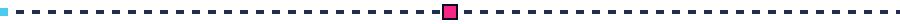

  

 

## > whoami

CS student I enjoy solving problems. The annoying it gets, the happier I am.

I'm curious about software, AI, and electronics, especially where they overlap.

## > currently_learning

| | Topic | Where I am | Goal |
|---|---|---|---|
| 🧠 | **Machine Learning** | coursework, scikit-learn & TensorFlow 
| 🌐 | **Web Development** | HTML, CSS, JavaScript foundations | clean full-stack apps without bloat |
| ⚔️ | **Competitive Programming** | DSA roadmap | a solid baseline for IEEE Xtreme |
| 🔌 | **Electronics & Arduino** | day 1 basics | bridge ML and hardware |
| 🀄 | **Mandarin (中文)** | for fun | just because I enjoy it |

## > built_so_far

- **Fazaa (فزعة)**: a student-to-student platform that matches students with mentors whose approach suits how they learn. Built at Mayda Hackathon.
- **Anime Dataset Analysis & EDA**: cleaning, exploring, and visualizing a large dataset. My completed personal project.
- **Hack the Future**: a hackathon prototype built under real constraints, with a team.
- **Heroz**: bug fixes and deep linking in Flutter on a production codebase, plus an AI & automation internship where I learned n8n workflows.
- **IEEE Student Branch @ DAH**: Vice President, running workshops and shared learning for the student tech community.

## > stats

  
  

## > connect

[LinkedIn](https://www.linkedin.com/in/haifa-al-nasi-997ab2216/) · [Portfolio](https://iteration-03.vercel.app/) · [Email](mailto:hsalnasi@dah.edu.sa)

 

