  

 

## > whoami

CS student I enjoy solving problems. The annoying it gets, the happier I am.

I'm curious about software, AI, and electronics, especially where they overlap.

## > stats

    
  

## > connect

[LinkedIn](https://www.linkedin.com/in/haifa-al-nasi-997ab2216/) · [Portfolio](https://iteration-03.vercel.app/) · [Email](mailto:hsalnasi@dah.edu.sa)

 

